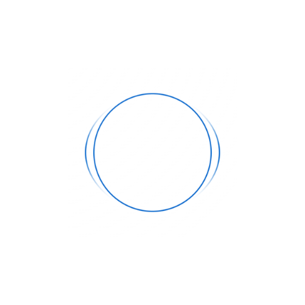

<div align="center">

**한국어** | [English](README.en.md)

<br/>

# SoundVisualizer



[](LICENSE)
[](https://developer.android.com/)
[](https://kotlinlang.org/)
[](https://developer.android.com/compose)
[](https://onnxruntime.ai/)

**실시간 소리 시각화와 AI 소리 분류를 담은 안드로이드 오버레이**

</div>

<br/>

> **SoundVisualizer**는 휴대폰에서 재생되는 소리를 실시간으로 받아 방향·크기·종류를 화면 가장자리의 그래픽과 진동으로 바꿔 주는 안드로이드 앱입니다.
단순한 파형 표시를 넘어, **YAMNet**과 **ONNX Runtime** 기반의 AI 소리 분류기로 지금 나는 소리가 환경음·대화음·위협음 가운데 무엇인지 알아보고 색과 진동으로 알려 줍니다.

---

## 📖 목차
- [프로젝트 배경 및 목적](#-프로젝트-배경-및-목적)
- [주요 기능](#-주요-기능)
- [시스템 및 AI 아키텍처](#-시스템-및-ai-아키텍처)
- [설치 및 실행 방법](#-설치-및-실행-방법)
- [권한과 개인정보](#-권한과-개인정보)
- [알아두세요](#-알아두세요)
- [빌드 가이드 (개발자용)](#-빌드-가이드-개발자용)
- [라이선스](#-라이선스)

---

## 🎯 프로젝트 배경 및 목적

### 청각장애인의 모바일 미디어 접근성 향상
휴대폰으로 즐기는 게임, 영상, 음악은 입체적인 소리로 몰입감을 높이지만, 청각장애인과 난청인에게는 오히려 넘기 어려운 벽이 됩니다. 자막은 대사만 전할 뿐, **소리가 나는 방향이나 발소리, 총소리 같은 위급한 효과음**은 알려 주지 못합니다.
SoundVisualizer는 **보이지 않는 소리의 방향·크기·종류를 화면과 진동으로 전해** 이런 정보의 불균형을 줄이고, 누구나 같은 경험을 할 수 있는 환경을 만드는 것을 목표로 합니다.

### 모두를 위한 활용성 확장
모바일 게이머에게는 발소리와 총소리의 방향을 알려 주는 보조 지표가 되고, 대중교통이나 도서관, 늦은 밤처럼 소리를 켤 수 없는 상황에서는 소리 없이도 흐름을 따라가게 해 줍니다.

---

## ✨ 주요 기능

### 1. 네 가지 표현 모드
같은 소리를 네 가지 모양으로 보여 줍니다. 그래픽은 다른 앱 위에 투명하게 떠 있고, 터치는 그대로 아래로 통과합니다.
- **파도**: 화면 테두리 전체가 소리 세기만큼 안쪽으로 밀려들고, 소리가 나는 쪽이 더 깊게 밀려옵니다.
- **패드**: 화면 가장자리 8곳에 막대가 떠올라 방향을 가장 또렷하게 보여 줍니다.
- **외곽선**: 파도의 윤곽선만 가늘게 그려 화면을 최대한 가리지 않습니다.
- **원형**: 화면 가운데의 고리가 소리 나는 쪽으로 부풀어 오릅니다.
- 크기, 진하기, 민감도, 속도, 크기 고정, 광원 같은 설정은 **모드마다 따로 저장**됩니다.

### 2. AI 실시간 소리 분류 (ONNX & YAMNet)
- **3가지 종류**: 들리는 소리를 `환경음`, `대화음`, `위협음`으로 나누고, 종류마다 색과 표시 여부를 따로 정합니다.
- **위협 단서**: 사이렌, 경보음, 폭발음, 폭죽, 경적, 깨지는 소리처럼 정해 둔 위협 단서는 AI 가 1순위로 꼽지 않아도 상위 5개 후보 안에 5% 이상이면 `위협음`으로 봅니다. 말소리가 더 크게 들리는 때처럼 오경보가 나기 쉬운 몇 가지 경우는 제외합니다.
- **바로 보이는 위협음**: 위협음은 색이 서서히 물들지 않고 즉시 바뀌고, 판정이 나오기 전에 끝나 버리는 짧은 위협음도 그 소리 크기대로 그립니다.
- AI 모델을 불러오지 못하면 홈과 설정에 안내하고, 모든 소리를 환경음 색으로 보여 줍니다.

### 3. 소리마다 종류 정하기 (분류 탭)
- AI 가 알아듣는 소리를 비슷한 것끼리 묶어 보여 주고, 묶음마다 `환경음`, `대화음`, `위협음` 가운데 무엇으로 볼지 선택합니다. **고급 모드**에서는 소리를 하나씩 바꿉니다.
- 이름으로 찾고, 종류나 바꾼 소리로 거르고, 한 번에 모두 되돌릴 수 있습니다. 바꾼 것은 AI 판정에 바로 반영됩니다.

### 4. 진동 알림
- 소리 종류마다 **꺼짐·느림·중간·빠름·연속** 가운데 진동 방식을, **10~100%** 로 세기를 정합니다. 처음에는 위협음만 ‘중간’으로 켜져 있습니다.
- 그 종류의 소리가 이어지는 동안 울리고, 소리가 멈추면 함께 멈춥니다. 화면 표시가 켜진 종류만 진동합니다.
- **잠금 화면 위협음 알림**: 폰이 잠겨 있는 동안 위협음이 들리면 잠금 화면에 알림을 띄웁니다. 화면이 꺼진 동안에는 소리를 계속 받도록 설정했을 때 꺼진 화면을 잠깐 켜고 알립니다.

### 5. 외부 사운드 모드
- 홈에서 켜면 폰 안의 소리 대신 **마이크로 주변 소리**를 듣고 같은 그래픽과 진동으로 알려 줍니다. 화재경보, 사이렌, 누가 부르는 소리처럼 폰 밖의 소리를 알 수 있습니다.
- 들은 소리는 크기를 재고 종류를 구분하는 데만 쓰며, **소리 자체는 파일로 남기거나 밖으로 보내지 않습니다.**
- 마이크 감도를 16단계로 조절할 수 있고, 폰이 자기 진동을 소리로 착각하지 않도록 진동하는 동안의 소리는 따로 다룹니다.

### 6. 손쉬운 조작
- **알림창**: 실행 중 알림에서 바로 끄거나 표현 모드를 바꿉니다.
- **빠른 설정 타일**: 앱으로 나가지 않고 알림창에서 켜고 끕니다.
- **튜토리얼**: 처음 열면 앱이 하는 일과 켜고 끄는 방법을 실제 그림과 진동으로 보여 줍니다.
- **도움말과 제보**: 사용법, 자주 묻는 질문, GitHub 이슈나 메일로 보내는 제보, 오픈소스 라이선스를 앱 안에서 봅니다.

### 7. 18개 언어
- 한국어, 영어, 일본어, 중국어(간체·번체), 베트남어, 태국어, 인도네시아어, 스페인어, 포르투갈어(브라질), 프랑스어, 이탈리아어, 독일어, 러시아어, 폴란드어, 터키어, 힌디어, 아랍어를 지원합니다.
- 기본은 폰 언어를 따르고, 홈 탭 오른쪽 아래의 지구본 버튼에서 바꿀 수 있습니다.

### 8. 가볍게 동작
- 120Hz 화면에서도 초당 60프레임으로 제한하고, **그래픽 덜 자주 그리기**를 켜면 초당 30번만 그립니다.
- 소리가 나지 않으면 그리기를 멈추고 대기 상태로 내려가며, 기본 설정에서는 **화면이 꺼지면 쉽니다.**

### 9. 개발자 모드
- 오버레이 왼쪽 위에 AI 가 들은 소리(상위 5개, 확신도, 걸린 시간)를 띄우고, 모든 결과를 CSV 파일로 기록할 수 있습니다.

---

## 🧩 시스템 및 AI 아키텍처

* **오디오 캡처**: 포그라운드 서비스가 `MediaProjection` 과 `AudioPlaybackCapture` 로 폰 안에서 재생되는 소리를 받고, 외부 사운드 모드에서는 `AudioRecord` 로 마이크 소리를 받습니다.
* **채널별 크기 측정**: 좌우 채널의 최고 크기를 C++(NDK)로 재어 렌더러에 넘깁니다.
* **ONNX 추론 파이프라인**: 0.25초마다 최근 0.975초의 소리를 모노로 섞고, 앨리어싱 방지 필터를 거쳐 16kHz 로 바꾼 뒤, 모델이 만들어질 때와 같은 방식의 Log-mel 스펙트로그램으로 바꿔 ONNX Runtime 의 YAMNet 으로 분류합니다. 모델 파일은 불러올 때 정해 둔 크기와 SHA-256 으로 확인하고, 각 단계는 기준 출력과 비교하는 테스트로 검증합니다.
* **오버레이 렌더링**: 터치가 통과하는 오버레이 창에 Jetpack Compose 캔버스로 그립니다. 스무딩은 60fps 기준으로 시간을 맞춰 화면 주사율과 상관없이 같은 느낌을 내고, 프레임마다 메모리를 새로 잡지 않습니다.
* **진동**: 소리 종류와 설정에 따라 울릴지 정하고, 정해 둔 박자대로 진동합니다.

데이터 흐름, 스레드 구성, 단계별 동작은 [아키텍처 문서](docs/ARCHITECTURE.md)에 정리되어 있습니다.

---

## 🚀 설치 및 실행 방법

**요구 사항**: Android 10 이상

1. **[GitHub Releases](https://github.com/bibibic76/SoundVisualizer/releases)** 에서 최신 `SoundVisualizer-vX.Y.Z.apk` 를 폰으로 받습니다.
2. 받은 APK 를 열고, "알 수 없는 앱 설치" 허용을 묻는 창이 뜨면 허용한 뒤 설치합니다.
3. 앱을 열면 **튜토리얼**이 먼저 뜹니다. 건너뛰어도 홈 탭의 **튜토리얼 보기**로 다시 볼 수 있습니다.
4. 홈에서 **실행**을 누르고 권한을 허용합니다. 게임이나 영상을 켜면 화면 가장자리에 소리가 그려집니다.
5. 끌 때는 앱의 **실행 종료**나 알림의 **중지**를 누릅니다.

자세한 사용법과 자주 묻는 질문은 앱의 **도움말** 탭에서 볼 수 있습니다.

---

## 🔐 권한과 개인정보

| 권한 | 쓰는 곳 |
|---|---|
| **다른 앱 위에 표시** | 게임과 영상 위에 그래픽을 띄웁니다. |
| **오디오 녹음 (마이크)** | 폰 안에서 재생되는 소리를 받는 데 필요합니다. 외부 사운드 모드를 켜지 않으면 **주변 소리를 듣지 않습니다.** |
| **화면 녹화 / 전송** | 안드로이드는 폰 안의 소리를 이 권한으로만 받게 합니다. **화면 자체는 캡처하지 않습니다.** 외부 사운드 모드에서는 묻지 않습니다. |
| **알림** (Android 13 이상) | 실행 중 알림과 중지 버튼, 직접 끄지 않았는데 꺼졌을 때의 안내에 씁니다. 거부해도 앱은 동작합니다. |

소리는 기기 안에서만 처리하고, 파일로 남기거나 밖으로 보내지 않습니다.

---

## 📌 알아두세요

- **좌우는 구분하지만 앞뒤는 구분하지 못합니다.** 폰의 소리는 두 채널이라, 화면 위·아래쪽 그래픽은 양쪽에서 비슷하게 들리는 소리와 공간감을 나타냅니다.
- **미디어와 게임 소리만 받습니다.** 통화, 알림음, 알람은 받지 않고, 소리 캡처를 막아 둔 앱(저작권 보호 영상 등)은 그려지지 않습니다. 이때는 홈과 실행 중 알림에 소리를 받지 못하고 있다고 알려 줍니다.
- **폰 안의 소리는 미디어 볼륨을 따릅니다.** 볼륨을 아주 낮추면 그래픽과 진동이 잘 반응하지 않습니다.
- **화면 녹화·공유·전송을 시작하면 꺼집니다.** 안드로이드는 이 기능을 한 번에 한 앱만 쓰게 합니다. 직접 끄지 않았는데 꺼지면 진동과 알림으로 알려 줍니다.
- **AI 분류는 틀릴 수 있습니다.** 안전이 걸린 상황에서 이 앱을 유일한 수단으로 쓰지 마세요.

---

## 🛠 빌드 가이드 (개발자용)

1. **요구 사항**: 최신 Android Studio, JDK 17, Android SDK(compileSdk 37). NDK 와 CMake 는 빌드할 때 맞는 버전을 받습니다.
2. **리포지토리 클론**:
   ```bash
   git clone https://github.com/bibibic76/SoundVisualizer.git
   ```
3. **빌드와 테스트**:
   ```bash
   ./gradlew assembleDebug        # app/build/outputs/apk/debug/ 에 폰용(arm64-v8a)과 에뮬레이터용(x86_64) APK
   ./gradlew testDebugUnitTest    # 유닛 테스트 (기기 불필요)
   ./gradlew lintDebug            # Lint
   ```
   계측 테스트(`connectedDebugAndroidTest`)는 끝날 때 앱을 지워 설정이 사라지므로, 개인 폰이 아닌 에뮬레이터에서 돌립니다.

**CI**: push 마다 GitHub Actions 가 빌드·유닛 테스트·Lint 를 돌리고 폰용 APK 를 **Artifacts** 에 올립니다. `develop`·`main` 으로 가는 PR 에서는 에뮬레이터 계측 테스트도 돕니다. `main` 에 `v1.0.0` 같은 버전 태그를 push 하면 릴리스 APK 를 만들어 Releases 에 붙입니다.

| 위치 | 역할 |
|---|---|
| `AudioCaptureService` | 소리를 받는 포그라운드 서비스 (폰 안의 소리, 외부 사운드 모드의 마이크) |
| `AudioEngine`, `cpp/native-lib.cpp` | 좌우 채널 크기 측정 |
| `ai/` | 전처리 → YAMNet → 위협 단서·후처리 |
| `OverlayService`, `VisualizerEngine` | 오버레이 창과 네 가지 모드 렌더링 |
| `feedback/` | 진동 알림 |
| `ClassifyTab`, `SoundCatalog`, `SoundGroups` | 분류 탭 |
| `HomeTab`, `SettingsTab`, `help/`, `tutorial/`, `language/`, `tile/` | 앱 화면, 도움말, 튜토리얼, 언어, 빠른 설정 타일 |

기여 방법은 [CONTRIBUTING.md](CONTRIBUTING.md), 자세한 구조는 [아키텍처 문서](docs/ARCHITECTURE.md)를 확인하세요.

---

## 📄 라이선스

이 프로젝트는 **Apache License 2.0** 으로 배포됩니다. 자세한 내용은 [LICENSE](LICENSE) 파일을 확인하세요.

분류 탭의 소리 묶음 표(`app/src/main/assets/sound_groups.tsv`)와 소리 이름(`app/src/main/res/values*/sound_names.xml`)은 AudioSet 온톨로지(CC BY-SA 4.0)를 바탕으로 만든 각색물이라 **CC BY-SA 4.0** 으로 배포합니다. 사용된 서드파티 구성요소(ONNX Runtime, YAMNet 모델, AndroidX 등)의 저작권과 라이선스는 [NOTICE](NOTICE) 파일에 정리되어 있습니다.

<br/>
<div align="center">
  <b>Built for Accessibility.</b>
</div>
