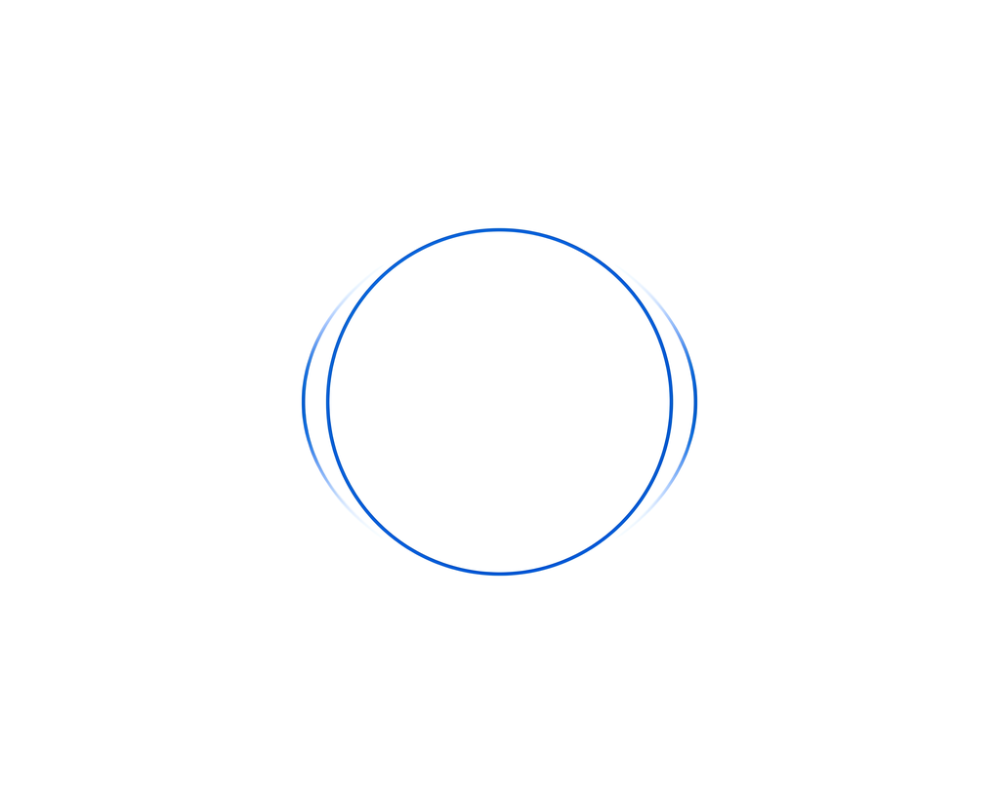
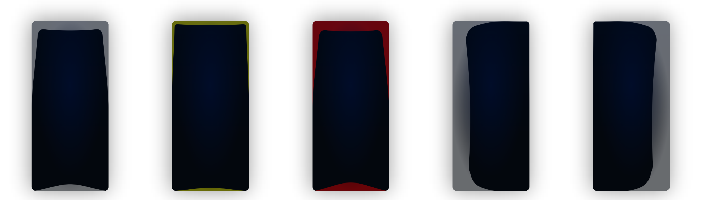

<div align="center">

[English](README.md) | [한국어](README.ko.md)

<br/>

# SoundVisualizer





[](https://www.apache.org/licenses/LICENSE-2.0)
[](https://developer.android.com/)
[](https://kotlinlang.org/)
[](https://developer.android.com/compose)
[](https://onnxruntime.ai/)

**Real-Time Audio Visualization & AI Sound Analysis Overlay for Android**

</div>

<br/>

> **SoundVisualizer** is an Android application that captures the audio playing on your phone in real time and translates its direction, intensity, and meaning into a graphical overlay and vibration. 
Going beyond simple waveform rendering, it integrates an AI sound classifier powered by **YAMNet** and **ONNX Runtime** to instantly identify the type of sound playing (ambient, speech, danger) and provide adaptive visual and haptic feedback.

---

## 📖 Table of Contents
- [Background & Objectives](#-background--objectives)
- [Key Features](#-key-features)
- [System & AI Architecture](#-system--ai-architecture)
- [Installation & Quick Start](#-installation--quick-start)
- [Build Guide (For Developers)](#-build-guide-for-developers)
- [License](#-license)

---

## 🎯 Background & Objectives

### Enhancing Media Accessibility for the Deaf and Hard of Hearing
Modern media content, including YouTube, OTT, and mobile games, relies heavily on spatial audio to maximize immersion. However, this creates a severe barrier for the deaf and hard of hearing. Traditional subtitle systems only deliver dialogue, completely omitting crucial acoustic information such as **sound direction, footsteps, or urgent sound effects (e.g., gunshots).**
SoundVisualizer was created to break down these barriers by **visualizing the intensity, classification, and spatial direction of invisible sounds** right on the phone in your hand. Our primary goal is to resolve this information asymmetry and guarantee an equal, fully accessible media consumption environment for everyone.

### Expanding Utility for All Users
This overlay technology is also highly beneficial for mobile gamers, providing a **tactical visual indicator (situational awareness)** in competitive environments. Additionally, it serves as a perfect alternative for users consuming media in public or silent environments where audio output is restricted, such as on public transport or late at night.

---

## ✨ Key Features

### 1. Diverse Spatial and Intensity Visualizer Modes
We provide 4 unique rendering modes that intuitively map sound intensity and direction (left and right):
- **Wave Mode**: Renders dynamic audio waves along the screen edges that fluctuate based on intensity.
- **Circle Mode**: Swells a ring in the center of the screen toward the side the sound comes from.
- **Pad Mode**: Displays glowing pads anchored to 8 spots around the screen edges.
- **Outline Mode**: A minimalist variation of Wave mode, showing only the thin borders of the wave to minimize screen occlusion.
- The graphics float transparently over other apps and let touches pass straight through. Size, opacity, sensitivity, speed, and glow are saved separately for each mode.
- **Simple settings**: The Settings tab has a picture-based view. Choose the shape from four cards drawn by the real visualizer, its size in three steps, and for each sound type whether it is shown and how strongly it vibrates. Everything else is under “Detailed”.

### 2. Control Without Leaving Your Game
Change what you see without switching away from the game or video you are watching.
- **Running notification**: Stop the visualizer or switch the visual mode straight from the notification.
- **Quick Settings tile**: Turn the visualizer on and off from the notification shade without opening the app.

### 3. Stereo Direction Detection
- Compares the left and right channels of the audio playing on the phone to show which side a sound comes from and how loud it is.
- Phone audio has two channels, so it tells left from right but not front from back. Graphics at the top and bottom of the screen show sound heard equally on both sides and a sense of space.

### 4. Real-Time AI Sound Classification (ONNX & YAMNet)
- **3-Class Detection**: Analyzes all incoming audio into `Ambient`, `Speech`, and `Danger` categories. Each category triggers independent, customizable UI colors and can be shown or hidden on its own.
- **Warning cues**: Sirens, alarms, explosions, fireworks, horns, breaking glass and similar warning sounds count as `Danger` even when they are only among the model's top five candidates (at 5% or more), so music or game audio can't drown them out. A few cases prone to false alarms, such as when speech is louder, are excluded.
- **Stable colors**: `Danger` appears on the first qualifying result; `Speech` and `Ambient` need two in a row, so the color doesn't flicker. The AI pauses while it's quiet and resumes as soon as sound returns.
- **Late danger**: Even a short `Danger` sound that ends before the AI decides is drawn at the size it had.

### 5. Choose How Each Sound Counts (Sounds Tab)
- Browse the 521 sounds the AI knows, grouped by similarity, and choose whether each group (or, in advanced mode, each sound) counts as `Ambient`, `Speech`, or `Danger`.
- Search by name, filter by type or by the sounds you changed, and reset everything in one step. The AI follows your changes immediately.

### 6. Vibration Alerts
- **Patterns per type**: Choose Off, Slow, Medium, Fast, or Continuous and a strength from 10 to 100% for each sound type, so you can tell sounds apart by touch. At first only `Danger` vibrates, at Medium. Simple settings offer just Off, Weak, and Strong.
- **Follows the sound**: It vibrates while that type of sound continues and stops when the sound stops, so you notice sounds even when you are not looking at the screen.
- **Lock screen alerts**: When a `Danger` sound is heard while the phone is locked, an alert appears on the lock screen.

### 7. External Sound Mode
- Listens to the sounds around you through the microphone instead of the audio playing on the phone, with the same graphics and vibration, so you can notice fire alarms, sirens, or someone calling you.
- What it hears is used only to measure loudness and recognize the sound type. The audio itself is never saved to a file or sent anywhere.
- Microphone sensitivity has 16 steps, and sound picked up while the phone vibrates is handled separately so the phone doesn't mistake its own vibration for sound.

### 8. Help, Notices, and Tutorial
- **Help tab**: Getting started, permissions, visual modes, sound types, FAQ, a report button that opens a prefilled GitHub issue or email, and the open source licenses.
- **Notices**: Home and the running notification tell you when no sound is reaching the visualizer, when sound type detection is unavailable, or why the visualizer stopped.
- **Tutorial**: The first time you open the app, a short tutorial shows how sound, direction, sound types, and vibration work, using the real renderer and real vibration. You can open it again from the Home tab.
- **Developer mode**: Shows what the AI heard (its top five sounds, how sure it was, and how long it took) at the top left of the overlay, and can record every result to a CSV file in the app folder.

### 9. Comprehensive Localization
- Supports 18 languages: Korean, English, Japanese, Chinese (Simplified and Traditional), Vietnamese, Thai, Indonesian, Spanish, Portuguese (Brazil), French, Italian, German, Russian, Polish, Turkish, Hindi, and Arabic (right-to-left). By default it follows the phone's language, and you can change it with the globe button on the Home tab.

---

## ⚙️ System & AI Architecture

The project is rigorously engineered for high-performance, real-time background processing with minimal battery and system overhead.

* **AudioPlaybackCapture**: A foreground service captures the audio other apps play through `MediaProjection`, or the microphone through `AudioRecord` in External sound mode.
* **Native Channel Levels**: The left and right peak levels are measured in C++ (NDK) for every buffer and handed to the renderer.
* **Zero-Allocation Rendering**: The Jetpack Compose canvas renderer allocates no memory per frame, preventing GC pauses and frame drops.
* **Frame-Rate Independent and Idle-Aware**: Smoothing is normalized to a 60 FPS reference and capped at 60 FPS even on 120 Hz screens (30 FPS with **Draw the graphic less often**). When nothing is visible, the overlay stops redrawing and wakes as soon as sound arrives, and by default it pauses while the screen is off.
* **ONNX Inference Pipeline**: Every 250 ms, the last 0.975 seconds of audio is downmixed to mono, resampled to 16 kHz through an anti-aliasing filter, turned into the log-mel spectrogram the model was exported with, and classified by YAMNet via ONNX Runtime. The model files are checked against a pinned size and SHA-256 at load. Each step is unit-tested against reference outputs.

---

## 🚀 Installation & Quick Start

SoundVisualizer is provided as an open-source APK for Android 10 or later.

1. Go to the **[GitHub Releases](https://github.com/bibibic76/SoundVisualizer/releases)** page.
2. Download the latest `SoundVisualizer-vX.Y.Z.apk` file to your phone and open it. Allow installing unknown apps if asked, then install.
3. Open the app. The tutorial appears first, and you can open it again from the Home tab.
4. Tap **Start** on Home and allow the permissions to activate the overlay: display over other apps, audio recording, and screen recording or casting, which Android requires to share the phone's own sound. The screen itself is never captured.

The sound is processed only on your phone and is never saved to a file or sent anywhere.

---

## 🛠 Build Guide (For Developers)

To build from source to modify the code or contribute to the project:

1. **Prerequisites**: The latest Android Studio, JDK 17, and the Android SDK (compileSdk 37). The matching NDK and CMake are downloaded during the build.
2. **Clone the repository**:
   ```bash
   git clone https://github.com/bibibic76/SoundVisualizer.git
   ```
3. Build and test from the repository folder:
   ```bash
   ./gradlew assembleDebug
   ./gradlew testDebugUnitTest
   ```
   Or open the project in Android Studio, build it, and run it on a phone or an emulator.

The app module contains the capture service (`AudioCaptureService`), the native level meter (`cpp/native-lib.cpp`), the AI pipeline (`ai/`), the overlay renderer (`VisualizerEngine`), and the vibration alerts (`feedback/`). See [CONTRIBUTING.md](CONTRIBUTING.md) for how to contribute and the [architecture document](docs/ARCHITECTURE.md) for the data flow and threads.

---

## 📄 License

SoundVisualizer is distributed under the **Apache License 2.0**. Anyone is welcome to use, modify, and share the code. See the [LICENSE](LICENSE) file for more information.

The sound groups and sound names in the Sounds tab are adaptations of the AudioSet ontology and are distributed under **CC BY-SA 4.0**. For licensing and copyright information regarding third-party libraries (ONNX Runtime, AndroidX, etc.) and the AI model used in this project, please refer to the [NOTICE](NOTICE) file.

<br/>
<div align="center">
  <b>Built for Accessibility.</b>
</div>
